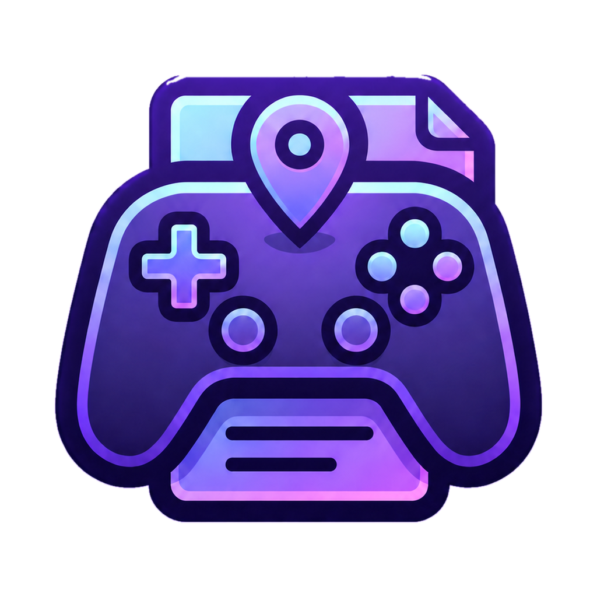
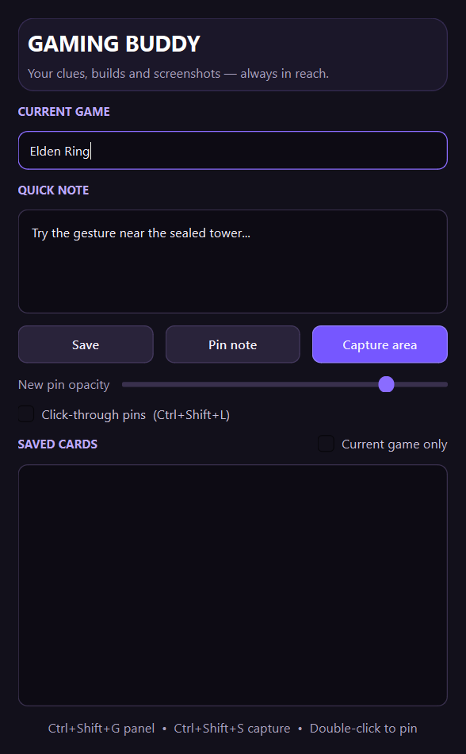

# Gaming Buddy

<p align="center">
  
</p>

Gaming Buddy is a lightweight Windows overlay for saving notes and pinning cropped
screenshots without leaving a game. This repository contains the first working prototype.




## About the project

Gaming Buddy keeps useful game information visible while you play. It provides a compact
control panel for capturing a clue, saving a short note, and placing movable cards over a
game window. The prototype is designed for quick interaction and stores its data locally.

## Prototype features

- Capture a region at the monitor's native pixel resolution and pin it above the game
- Instantly capture a full monitor to the library without selection, countdown, or focus changes
- Choose whether captures are pinned, saved quietly, or reviewed before saving
- Delay area selection by 3 or 5 seconds and return directly to the game after capture
- Import PNG, JPEG, BMP, and WebP images by file picker, drag and drop, or clipboard paste
- Preserve imported files at their original quality and skip duplicate image content
- Annotate screenshots with a pen, arrows, rectangles, text, and a pixel-restoring eraser
- Undo, redo, or reset edits and save the result as a new lossless copy
- Create, save, and pin quick text notes
- Format notes with Markdown and preview headings, lists, emphasis, quotes, and code
- Apply common Markdown formatting from the note toolbar or keyboard shortcuts
- Create checklists and tick tasks directly on pinned notes with saved completion progress
- Autosave unfinished notes locally and restore them after an interrupted session
- Move and resize every pinned card
- Snap pins to nearby screen edges and lock their position and size
- Collapse pins into compact title bars and expand them when needed
- Open screenshots at full resolution with Fit, 100%, and zoom controls
- Extract text from screenshots locally, review it, and save it with the image card
- Adjust overlay opacity
- Switch pins into click-through mode
- Enter a distraction-free focus mode with unified temporary pin opacity
- Organize cards by game name
- Add reusable tags such as map, boss, code, build, or puzzle to saved cards
- Search saved cards by title, note text, extracted screenshot text, tag, or game
- Filter the library by tag, card type, pinned state, favorites, or current game
- Sort the library by creation date or title and remember the chosen order
- Select multiple library cards to pin, favorite, organize, retag, or delete them together
- Export selected cards as a portable ZIP with original images, a readable index, and metadata
- Preview and selectively import shared card packs offline without overwriting existing cards
- Preview images and notes directly from the library with quick card actions
- Find and show any saved card from a keyboard-first in-game search overlay
- Cycle through one pinned card at a time with favorites first and restore the prior layout
- Save multiple named pin layouts per game and switch between them without moving cards again
- Mark important cards as favorites and filter the library
- Edit saved card titles, game names, and note text without recreating them
- Copy note text or full-resolution screenshots directly to the clipboard
- Open a screenshot's local folder from its card menu
- Move deleted cards to a 30-day recycle bin with quick undo and restore controls
- Detect the active Windows game and switch to its linked card profile automatically
- Show only the active game's saved pins, plus General pins, when profiles switch
- Optionally hide pins outside linked games and restore them when gameplay resumes
- Back up cards, screenshots, profiles, and portable settings to a verified ZIP archive
- Restore backups by safely merging cards and skipping exact duplicates
- Restore pinned cards, positions, sizes, opacity, and collapsed state after restarting
- Temporarily show or hide all saved pins without deleting them
- Keep restored pins visible when monitors or resolutions change
- Persist everything locally in SQLite
- Configurable global shortcuts and a system tray menu
- Single-instance startup: opening the app again restores the existing control panel
- Central settings window for overlay, profile, startup, update, and shortcut preferences
- Local troubleshooting checks and a privacy-safe diagnostic report for support
- First-run setup guide with a quick overview of capture, pins, and shortcuts
- Optional launch at Windows sign-in without administrator access
- Per-user Windows installer with clean update and uninstall support
- Check GitHub Releases for updates and install a verified Windows release with permission
- No code injection and no game-memory access

## Shortcuts

Gaming Buddy runs once per Windows user. Opening another copy shows the existing panel,
including when it is hidden or minimized, without adding another tray icon or shortcut
listener. If the running copy is unresponsive, startup shows a message instead of opening
a competing copy. Wait and retry, or close Gaming Buddy in Task Manager before reopening it.
After an unexpected exit, the next launch recovers the startup lock automatically.

| Shortcut | Action |
| --- | --- |
| `Ctrl+Shift+G` | Show or hide the control panel |
| `Ctrl+Shift+F` | Open the quick card finder |
| `Ctrl+Shift+S` | Capture a screen region |
| `Ctrl+Shift+D` | Save a full-monitor screenshot immediately |
| `Ctrl+Shift+L` | Toggle click-through mode for all pins |
| `Ctrl+Shift+M` | Enter or leave focus mode |
| `Ctrl+Shift+Left` | Show the previous pinned card |
| `Ctrl+Shift+Right` | Show the next pinned card |
| `Ctrl+Shift+Up` | Leave single-pin view and restore the workspace |

Choose **Keyboard shortcuts…** in the control panel or tray menu to replace any default.
Changes are saved locally and take effect immediately. Gaming Buddy prevents duplicate,
empty, and modifier-free shortcuts.

Full-monitor capture always saves a lossless PNG to the current game profile without
opening review or creating a new pin. Choose the primary monitor, the monitor under
the pointer, or a specific connected monitor in **Settings > Capture**. The panel and
visible pins are hidden briefly before capture; pins return without activation, and
the panel stays hidden. Capture notifications follow the existing notification setting
and may be suppressed by Windows Focus Assist.

The area-capture delay and review settings do not apply to full-monitor capture. If a
selected monitor is disconnected, no other display is captured automatically. Choose
another monitor in Settings before retrying. Monitor selection is device-specific and
is not included in portable backups. When upgrading an existing shortcut setup, a free
alternative is assigned if `Ctrl+Shift+D` is already used by another action.

## Run from source

Personal, non-commercial use and evaluation are permitted without a separate written
request, including downloading the source, installing dependencies, running tests, and
building a local unmodified copy. Redistribution, source changes, and commercial use
require written permission. See [LICENSE](LICENSE) for the full terms.

Windows 10 version 1809 or newer and Python 3.11 or newer are required.

```powershell
git clone https://github.com/amkumirab/gaming-buddy.git
cd gaming-buddy
py -m venv .venv
.venv\Scripts\Activate.ps1
python -m pip install -e ".[dev]"
gaming-buddy
```

You can also run it without installing the command:

```powershell
python -m gaming_buddy
```

## Install on Windows

Version `0.1.0` is awaiting clean-Windows installation verification. There is currently
no published installer on the [Releases](https://github.com/amkumirab/gaming-buddy/releases)
page. Use **Run from source** above until the first official release is available.
Successful manual [Windows build runs](https://github.com/amkumirab/gaming-buddy/actions/workflows/windows-release.yml)
provide test artifacts named `gaming-buddy-windows-<run-id>`; downloading Actions artifacts
requires a GitHub account. These are test builds, not official releases.
For the download, checksum, and feedback steps, see
[Try a development installer](docs/windows-release.md#try-a-development-installer).
Older artifacts do not include later changes to the program or its license; check the
run's commit and the license shown by that installer before testing.

The planned release assets are `Gaming-Buddy-Setup-0.1.0-x64.exe` and
`Gaming-Buddy-Setup-0.1.0-x64.exe.sha256`. The installer bundles its runtime and does not
require Python or administrator access. It creates a Start menu shortcut and
can optionally create a desktop shortcut. Launching the application at the end of setup
is also optional.

Updates reuse the same installation and preserve the local workspace. Uninstalling the
application removes program files, shortcuts, and its launch-at-sign-in entry but keeps
notes and screenshots under `%LOCALAPPDATA%\GamingBuddy`. Interface preferences, shortcuts,
and game profiles remain in the current user's Windows settings. During an interactive
uninstall, the user can explicitly choose to permanently remove this workspace and its
settings. Choosing **No**, or running a silent uninstall, preserves them by default.

Unsigned builds may show a Windows SmartScreen warning. Release builds include
a `.sha256` file so the installer can be checked before it is run.

See [Windows release verification](docs/windows-release.md) for the required checks,
checksum command, and the distinction between automated and clean-machine testing.

## How to use

1. Enter the current game name in the top field.
2. Write a note and choose **Save** or **Pin note**. Saved notes support Markdown formatting;
   use **Edit** to apply formatting from the toolbar, then switch from **Write** to **Preview**
   to check the rendered result. `Ctrl+B` and `Ctrl+I` format selected text while writing.
   Unfinished text is saved locally after a short pause and restored the next time the app
   starts. Choose **Discard draft** to remove it without creating a card.
3. Choose **Capture area**, drag around a clue or map, and release. Open the **Capture** tab in
   Settings to save and pin immediately, save quietly to the library, or review each capture.
   You can also add a 3- or 5-second delay, keep the panel hidden afterward, and control system
   notifications. Cancelling restores the panel only when it was visible before capture started.
4. Choose **Import image…**, drag image files onto the panel, or paste an image with `Ctrl+V`.
   Select **Save** or **Save and pin** after checking the preview.
5. Right-click an image card or pin and choose **Annotate image…**. Mark it with a pen,
   arrow, rectangle, text, or eraser, then choose **Save copy** or **Save and pin**.
6. Drag pins by their header and resize them from the bottom-right corner. Move a pin near
   a screen edge to snap it into place, then right-click it and choose **Lock pin position**.
7. Double-click a pin header or use its **−** button to collapse it into a compact title bar.
   Use **Collapse all** and **Expand all** to manage the whole workspace at once.
8. Right-click an image card or pin and choose **Extract text…**. Select an installed
   language or use the automatic option, review the result, and save it with the card.
9. Double-click a pinned image to inspect the lossless original at full resolution.
10. Use **Hide all pins** to clear the screen without losing the saved workspace.
11. Enable **Click-through pins** so mouse input goes to the game.
12. Set the Focus opacity and press `Ctrl+Shift+M` to hide the panel, show the current
    pinned workspace, and make every visible pin click-through. Press it again to restore
    the previous panel, visibility, opacity, and interaction state.
13. Press `Ctrl+Shift+F`, type a clue, code, or card name, and press Enter to show it
    immediately. Saved screenshot text is included in these results.
14. Press `Ctrl+Shift+Right` or `Ctrl+Shift+Left` to show one pinned card at a time. Cards
    from the active game profile are cycled with Favorites first. Press `Ctrl+Shift+Up` to
    restore the exact visibility that each pin had before cycling.
15. Select a card in the library to preview its image or full text. Use the preview panel to
    pin, edit, copy, or extract screenshot text without opening a context menu. Close the
    panel when you want the compact layout and reopen it with **Preview**.
16. Open **Settings…** to manage overlay opacity, profile behavior, startup, updates, and
    global shortcuts in one place. Changes are applied only after choosing **Save**.
17. Choose **Edit** on a card to add comma-separated tags such as `map`, `boss`, or
    `build`. Open **Filters** to combine tag, type, pinned, favorite, and game filters.
    Use `Ctrl+Click`, `Shift+Click`, or `Ctrl+A` in the library to select multiple cards,
    then open **Bulk actions** to update them together.
    Beside library search, use **Sort by** to choose **Default**, **Newest first**,
    **Oldest first**, or **Title A–Z**. Default keeps pinned cards first, then favorites,
    then the most recently changed cards. Date sorting uses the original creation time,
    so moving a pin or editing a note does not change that order. Title sorting ignores
    ASCII letter case; it is not locale-specific. Your choice is saved locally and
    survives restarting. Sorting preserves the current card, multi-selection, and preview,
    works with search and filters, and is not reset by **Clear filters**. It does not
    change quick-finder ranking or pin cycling order.
    For task notes, select lines and choose **Checklist** in the note editor or quick-note
    field. Existing checked items stay checked, and insertion can be undone in one step.
    Write tasks as `- [ ] Bring a potion` and completed tasks as `- [x] Check the map`.
    On a pinned note, click the checkbox to toggle it, or place the text cursor on a task
    line and press **Space**. The counter shows how many items are complete. Clicking
    ordinary text or selecting text to copy does not toggle tasks. Changes are saved
    immediately and survive restarting, exporting, and importing the note.
    Position locks still allow ticking tasks; click-through and focus mode disable task
    changes. Fenced/indented code examples and quoted task examples are not interactive.
    A failed save keeps the previous state and displays an inline message. If a note was
    changed or deleted elsewhere, reopen or edit it before retrying; it is not overwritten.
18. Select one or more library cards and choose **Export card…** or **Export selected…** to
    create a portable ZIP containing original-resolution images, a readable Markdown index,
    and structured metadata. Missing image files are reported without dropping their cards.
    To receive a pack, choose **Import cards…** below the library search. Check the cards
    you want, inspect the image or plain-text preview, and choose **Import selected**.
    Missing-image cards are shown but cannot be selected. Keep each card's original game,
    or enable **Use one game for selected cards**; an empty destination means General.
    Notes keep their line breaks, tags, favorites, and creation dates. Original image bytes
    are copied without recompression. Imported cards start unpinned; your current game,
    search, sorting, filters, settings, and workspace layouts are not changed.
    Exact duplicates in the live library or within the selected pack are skipped. Identity
    uses card type, destination game, title, exact text, normalized tags, and image bytes;
    favorites, dates, and pin positions do not make a separate card. Changed text, including
    whitespace, is kept as a new card. Cancel before confirmation to leave the library
    untouched. Reading and duplicate checks run in the background, and closing the app
    cancels the reader before shutdown. Use **Restore backup…**, not this importer, for
    full workspace backups.
19. Right-click a saved card or pin to collapse, lock, edit, copy, or locate its original file. Use
    **Unlock all** in the panel or Tray when you want to rearrange the whole workspace.
20. Move a card to **Recently deleted** and use **Undo** immediately if it was accidental.
21. Open a game, return with the panel shortcut, enter its name, and choose
    **Link detected app**. Enable **Auto-switch game profiles** to switch automatically.
22. Enable **Hide pins when a linked game loses focus** to keep overlays off other apps.
    Manual **Hide all pins** remains in effect when you return to the game.
23. Choose **Layouts…** to save the current pins, positions, sizes, visibility, opacity,
    collapsed state, and lock state as a named layout for the current game. Applying a layout
    reuses the existing cards, and the active layout returns with that game profile.
24. Choose **Backup workspace…** to save a portable ZIP. Use **Restore backup…** to inspect
    and merge cards, images, settings, and named layouts without deleting the current library.
25. Choose **Updates** in the panel or **Check for updates…** in the tray. When a newer
    GitHub Release is available, review its notes and choose **Download and install**. Gaming
    Buddy verifies the published SHA-256 checksum and asks again before starting the Installer.
26. Toggle **Check for updates automatically** in the tray. Automatic checks run no more than
    once per day, never download in the background, and only show a notification when a newer
    release exists.
27. Open **Getting started…** from the panel or tray whenever you want the quick guide again.
28. Toggle **Launch at Windows sign-in** from the tray to keep global shortcuts ready after
    signing in.
29. Open **Settings > Troubleshooting** and choose **Run checks** to check note-folder
    write access, PNG saving, the tray icon, and the global shortcut listener. Review the
    report before choosing **Copy diagnostic report** to share it with support. Global
    shortcuts are intentionally paused while Settings is open; their prior listener state
    is reported separately from a failure. Recent error categories cover the current session
    only and do not include the original exception text.

Captured images and the SQLite database are stored under:

```text
%LOCALAPPDATA%\GamingBuddy
```

## Project structure

```text
gaming-buddy/
├── src/gaming_buddy/
│   ├── app.py          # Application entry point
│   ├── single_instance.py # Per-user startup lock and local panel activation
│   ├── dashboard.py    # Main control panel
│   ├── card_preview.py # Library image, note, and metadata preview panel
│   ├── capture.py      # Screen-region capture
│   ├── capture_workflow.py # Capture behavior and delay preferences
│   ├── card_editor.py  # Saved-card editor
│   ├── markdown_view.py # Safe shared Markdown note preview
│   ├── bulk_card_dialog.py # Multi-card game and tag changes
│   ├── card_export.py   # Portable selected-card ZIP exports
│   ├── card_pack.py     # Bounded card-pack ZIP and image validation
│   ├── card_pack_import.py # Duplicate planning and atomic card imports
│   ├── card_pack_dialog.py # Offline preview, selection, and background reader
│   ├── pin.py          # Movable overlay cards
│   ├── focus_mode.py   # Temporary distraction-free presentation state
│   ├── pin_cycle.py    # Single-pin cycling and visibility restoration
│   ├── workspace_presets.py # Named per-game pin layouts
│   ├── preset_dialog.py # Layout save, apply, rename, and delete controls
│   ├── profiles.py     # Active-game detection and profile mappings
│   ├── profile_dialog.py # Profile manager
│   ├── quick_finder.py # Keyboard-first saved-card search overlay
│   ├── note_drafts.py  # Crash-safe local quick-note draft storage
│   ├── text_recognition.py # Local Windows screenshot text recognition
│   ├── text_recognition_dialog.py # Recognition review and language controls
│   ├── tags.py         # Tag normalization and display helpers
│   ├── hotkeys.py      # Global keyboard shortcuts
│   ├── image_annotation.py # Non-destructive screenshot annotation tools
│   ├── image_import.py # Lossless image import and duplicate checks
│   ├── pin_visibility.py # Focus-aware pin visibility controller
│   ├── shortcut_dialog.py # Shortcut settings dialog
│   ├── settings_dialog.py # Central application settings and About panel
│   ├── diagnostics.py   # Local checks and fixed, session-only error categories
│   ├── troubleshooting.py # Diagnostic report preview and explicit clipboard copy
│   ├── onboarding.py   # First-run setup guide
│   ├── updates.py      # Release checks, secure downloads, and version comparison
│   ├── update_dialog.py # Release notes and update consent
│   ├── startup.py      # Per-user Windows startup setting
│   ├── trash_dialog.py # Recently deleted cards and permanent cleanup
│   ├── workspace_backup.py # Verified backup and restore
│   └── storage.py      # Local SQLite persistence
├── tests/              # Automated behavior, storage, and packaging tests
├── packaging/          # Windows executable and installer configuration
├── scripts/            # Release metadata validation
├── .github/workflows/  # Test and tagged-release automation
└── docs/               # Project preview assets
```

## Privacy and storage

- Notes and captured images remain on the user's computer.
- Troubleshooting reports exclude saved content, game names, file paths, account names,
  and keyboard input. Checks create and remove small temporary SQLite and PNG files without
  reading saved cards. Error categories are kept only in memory, and reports are never
  uploaded automatically. Copying a report replaces the clipboard only on request.
- Markdown note previews do not automatically load linked local or remote images.
- Unfinished quick-note drafts remain local and are removed after saving, pinning, or choosing
  **Discard draft**.
- Deleted cards and their images remain recoverable locally for 30 days unless the recycle
  bin is emptied earlier.
- Interface preferences, shortcut mappings, and profiles use the current Windows account.
- Recent quick-finder searches stay in the current Windows account settings.
- Screenshot text recognition runs locally through installed Windows language packs; images
  are not uploaded for recognition.
- The prototype does not require an account or cloud connection.
- Captures are created only after the user activates the capture shortcut.
- Delayed captures wait locally before showing the selection overlay; they do not record the
  screen during the countdown.
- Imported images are copied into the local capture library only after confirmation.
- Screenshot annotations are saved as new local PNG files; the source image is unchanged.
- Active-game detection reads only the foreground window title, process ID, and executable name.
- Automatic profile switching is disabled by default and profile links remain local.
- Focus-aware pin hiding is disabled by default and works only with locally linked games.
- Launch at sign-in is optional and uses the current user's Windows startup entry.
- Backups are written only to the location selected by the user and are never uploaded.
- Card exports are written only to the selected location and omit local database IDs and source
  file paths. Their Markdown and JSON contents may include the selected notes and extracted text.
- Shared card packs are local, unencrypted ZIP files. The importer never extracts archive paths,
  opens links, or loads remote images. It accepts version 1 card exports, not workspace backups.
  Limits are 128 MiB compressed, 256 MiB uncompressed, 4 MiB metadata, 1,000 cards,
  64 MiB per image, 32 million pixels per image, and 64 million pixels across all images.
  ZIP64, encrypted files, unsafe paths, unknown members, and corrupt images are rejected.
  Validation detects unsupported or damaged content; it does not authenticate the sender.
  On a save failure, new cards and tags are rolled back and only newly created image copies
  are removed. Existing cards and images are never overwritten.
- Backup ZIP files are not encrypted, so they should be stored in a trusted location.
- Optional update checks contact only the project's GitHub Releases API. They can be disabled
  from the tray menu.
- Updates are never downloaded or installed without the user's explicit choice. Installer
  downloads are accepted only when their size and published SHA-256 checksum match.
- Pin lock state is stored locally with the rest of each card's workspace layout.
- Pin collapsed state and expanded size are stored locally and included in workspace backups.
- Named workspace layouts are stored locally in SQLite and included in version 2 backups.
- Backups created by earlier versions remain restorable.
- Saved cards and captured images can be removed by deleting `%LOCALAPPDATA%\GamingBuddy`.

## Compatibility and fair-play note

The MVP uses ordinary top-level Windows windows. It does not inject code, read game
memory, automate input, or bypass anti-cheat software. Borderless-windowed mode gives
the most reliable overlay experience. Some exclusive-fullscreen games may hide normal
desktop overlays. Always follow the rules of the game you are playing.

## Current scope and roadmap

This release intentionally focuses on the core overlay and notebook experience. Planned
improvements include spoiler-safe layered hints, optional web lookup, and better
multi-monitor support.

## Development

```powershell
python -m pytest
python -m ruff check .
```

Test success requires both passing assertions and a zero process exit code. The shared
Qt fixture keeps a strong application reference for the whole test process.
Startup unit tests use an isolated application double so they cannot
change the shared GUI's name, style, icon, or exit behavior. A subprocess lifecycle test
runs the real app against disposable data, checks tray and shortcut readiness, opens a
second copy, and verifies normal shutdown. It does not test the packaged installer.
The update dialog also has an isolated native Qt shutdown regression test. Its button
handlers use bound receiver methods rather than lambdas that retain the window until
finalization. Update results are emitted only after the checking state has been cleared,
so a result handler can safely start the next operation.

Build the Windows application, installer, and SHA-256 checksum with:

```powershell
python -m pip install -e ".[dev,packaging]"
./scripts/build_windows_installer.ps1
```

The script validates synchronized version metadata before building. It requires Inno Setup 6.
Pass `-SkipApplicationBuild` when the PyInstaller bundle has already been created. Silent
uninstall keeps user data; administrators can pass `/PURGEUSERDATA` to the uninstaller only
when permanent workspace removal is intended.

Pushing a tag that exactly matches the project version, such as `v0.1.0`, runs the
Windows release workflow and creates a draft with the installer and its SHA-256 checksum. Running
the workflow manually builds a downloadable test artifact without publishing a release.
Both paths test installation, bundled-runtime startup, shortcut targets, same-version
reinstallation, and silent-uninstall data retention on a disposable Windows runner.
The separate installer-test artifact contains the checks and installation logs. The
runner has Python installed, so this is not a substitute for the clean-machine desktop
checks required before pushing a release tag.
Tagged builds create a draft release. Publish the draft only after desktop acceptance
of those exact installer bytes, then link README to the downloadable official release.

## Closing the application

Use **Quit** in the tray menu to close Gaming Buddy. Closing the main window still hides
it in the tray. Quit pauses shortcuts, stops pending captures, and cancels update downloads
cooperatively. If an update check, download, or text-recognition worker is still running,
the app displays **Finishing tasks…** and stays responsive until it finishes.

Choose **Stay open** to cancel closing. Pending captures and cancelled downloads do not
restart automatically, but shortcuts, note autosave, and normal controls are restored.
If background work has not finished after 60 seconds, the app stays open without forcibly
terminating any thread. Wait for the task to finish and try Quit again.

Before the final exit, Gaming Buddy saves the quick-note draft, pin layout, and window
geometry. A draft or pin-layout save failure keeps the app open so you can resolve folder
access or copy your note. Unreviewed extracted screenshot text is not automatically saved
to a card. A confirmed update installer starts only after background work and local saves
have completed; cancelling closing also cancels that pending installer launch.

Lifecycle tests use real worker threads and isolated app processes with controlled offline
backends. These tests do not replace a packaged-installer or clean-machine desktop test.
Qt thread cleanup follows the completion semantics in the
[QThread documentation](https://doc.qt.io/qt-6/qthread.html#isFinished).

## Ownership and license

Copyright © 2026 **Amir Ali Mirab Zadeh Ardekani**. All rights reserved.

This is proprietary software with permission for personal, non-commercial use and
evaluation. You may install and run it, or download the source and build an unmodified
local copy, without requesting separate written permission. Ownership is retained by
the author. Modification, redistribution, commercial use, and derivative works require
prior written authorization, subject to the third-party and statutory exceptions in
[LICENSE](LICENSE). Your notes and screenshots remain your own content.
