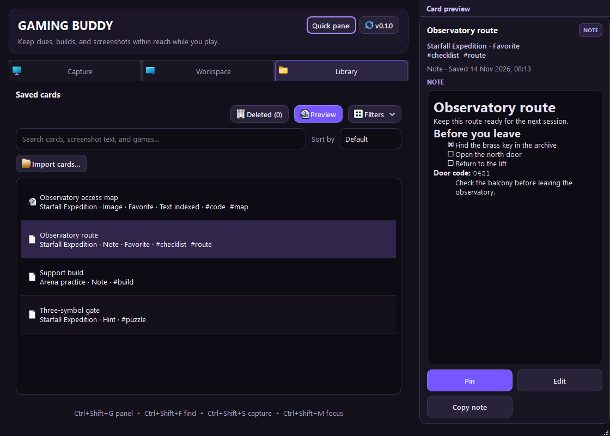
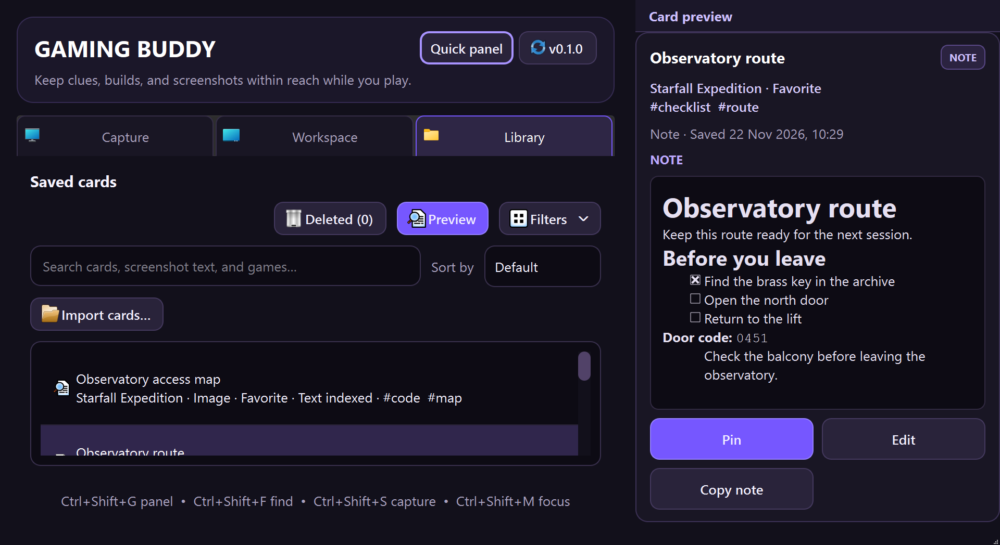
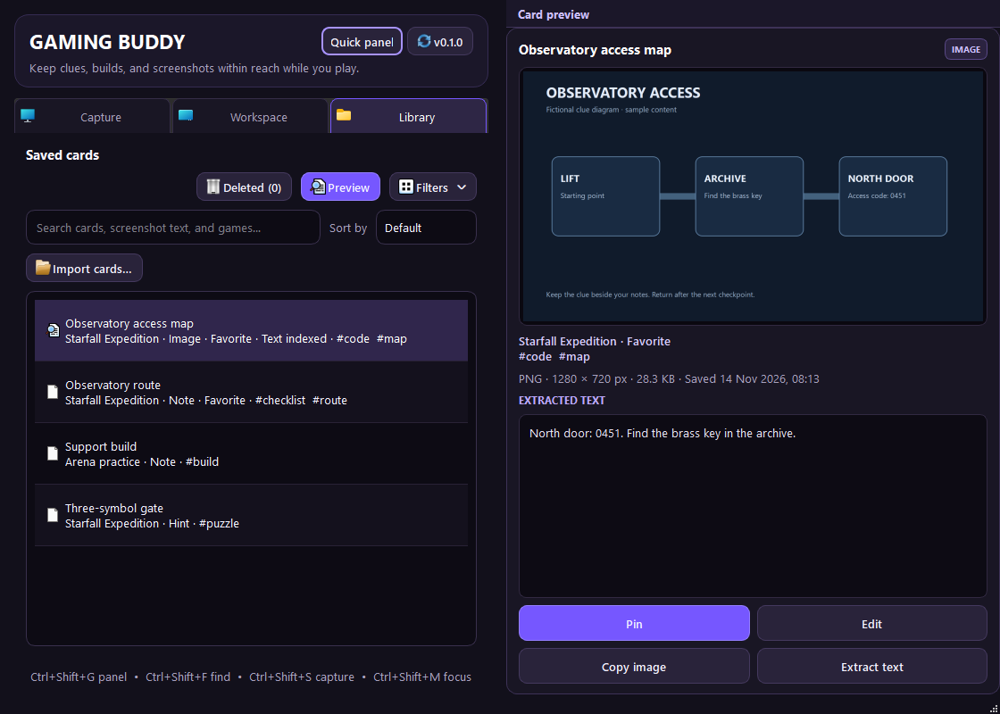
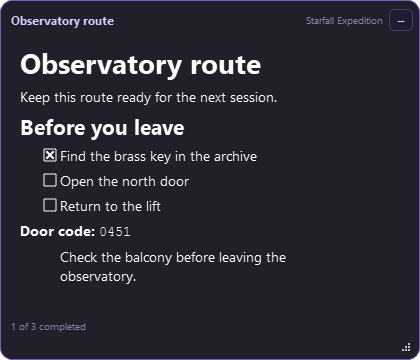
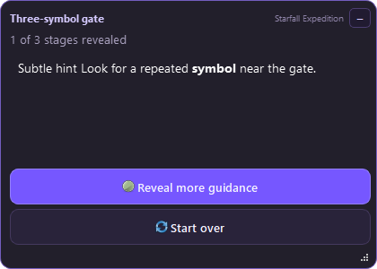
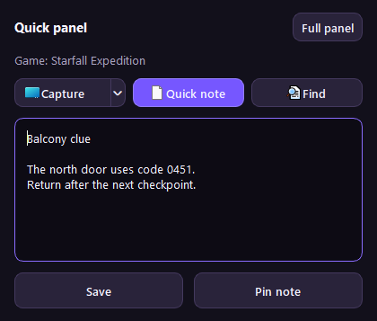
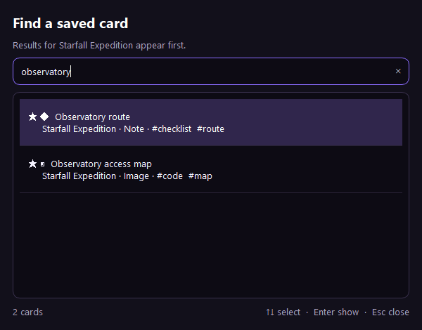
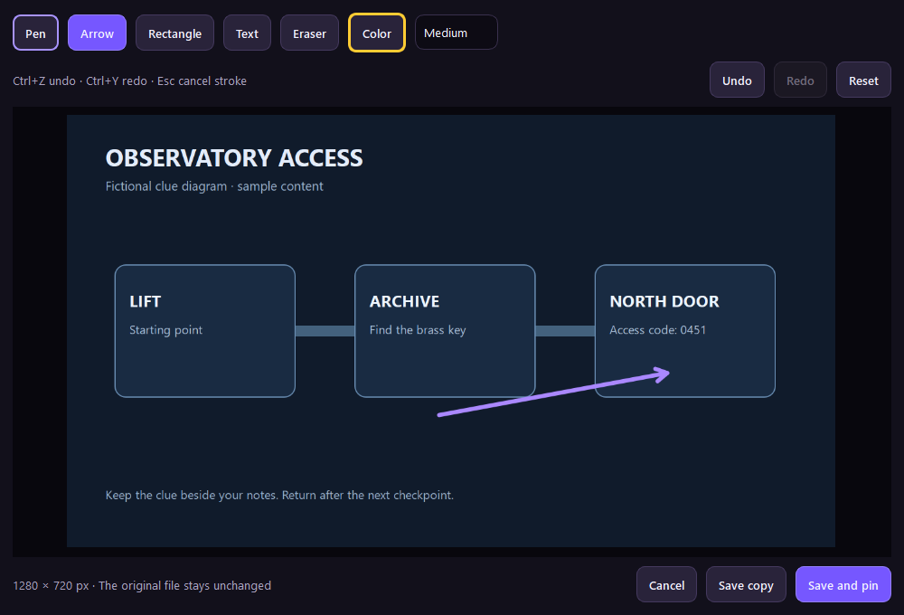
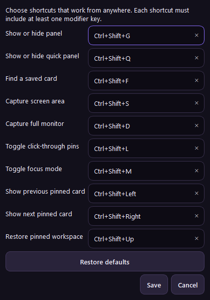

# Gaming Buddy screenshots

These are lossless captures of the actual application widgets on Windows 11,
using the native Qt Windows backend. The cards, game names and clue diagram are
fictional sample content. No personal workspace or desktop content is shown.

## Library and Markdown preview

Search and organise cards by game, tags and favourites. The selected note keeps
its headings, code and checklist visible in the preview alongside the library.



## Library at 200% scaling

The three tabs, shortcut footer, and card preview remain accessible when Windows
gives the app less room. This capture shows the library on a 1920 × 1080 Windows
display with process-local Qt scaling set to 200%. The complete window, including
its title bar, fit inside the available 960 × 540 logical pixels during verification.



## Saved images and searchable text

An image card keeps the original image, its pixel dimensions and the text saved
with it. This example uses a code-drawn diagram and seeded text; it is not a
screenshot from a game or a record of an OCR engine run.



## Pinned notes and checklists

Keep a note visible independently of the main panel. Checklist progress appears
at the bottom of the pin.



## Progressive hint cards

The first hint is revealed here. Further guidance and the final solution stay
hidden until another reveal is requested.



## Quick panel

Capture, write a quick note or find a saved card from the compact panel. A note
can be saved to the library or saved and pinned.



## Quick finder

Find saved cards by title, note text, indexed image text, tag or game. Search
results show a short preview and can be opened as pins.



## Screenshot annotations

Mark a clue with a pen, arrow, rectangle or text. Annotations are saved as a new
copy so the original image is preserved. The arrow below was added through the
application's annotation document; its undo and save controls reflect that change.



## Configurable keyboard shortcuts

Review and change the global shortcuts in one dialog. This capture shows their
configuration; it does not establish whether a particular game accepts them.



## Capture provenance and reproduction

The 200% library screenshot was captured on November 22, 2026 after the dashboard
geometry fix. It used the same capture script with `QT_SCALE_FACTOR=2`. The eight
original screenshots were captured as follows.

- Date: 2026-11-14.
- Application source: `b011a7afc84f2c00323a3a159a0a210f5e118013`, version `0.1.0`.
- Host: Windows 11, build 26300; Qt platform `windows`, device pixel ratio `1.0`.
- Method: `QWidget.grab()` on the real, unmodified application widgets, saved as PNG.
- Fixtures: a disposable SQLite library and explicit INI settings, outside this folder.
- Automatic startup tasks and global shortcut listeners are not started by the capture tool.
- The tool checks that the quick note saves, only the first hint is revealed, and
  the native user's application settings remain unchanged.

To capture a new set from a Windows source checkout with its dependencies installed:

```powershell
python scripts/capture_showcase.py `
  --workspace build/showcase-local-session `
  --output build/showcase-local-images
```

Both directories must be new and separate. The tool refuses to overwrite an
existing directory. Its capture report stays in the disposable workspace;
only reviewed PNG images belong in this gallery.

These are source-application previews, not proof of installed-app, clean-Windows,
game compatibility or performance acceptance. See the
[Windows release checks](../windows-release.md) for those results and requirements.
